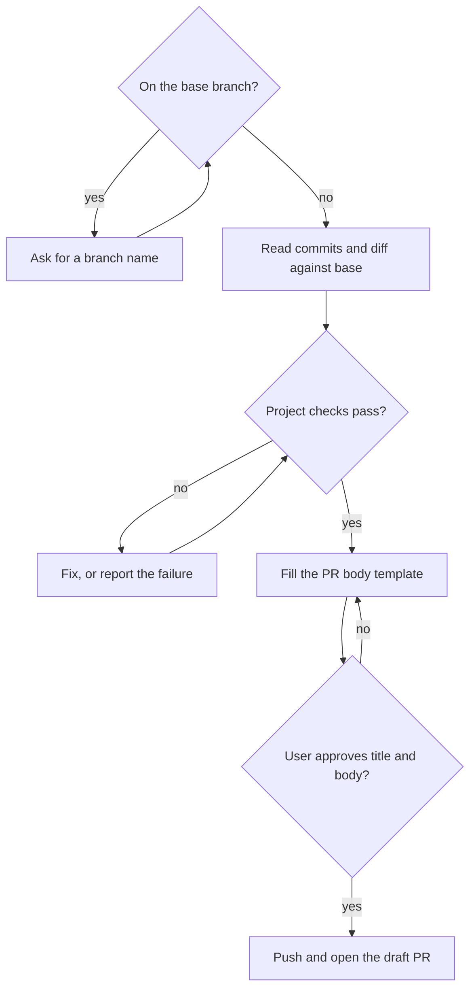

## Goal

A draft PR a reviewer understands before opening a single file.

## In

- Current branch, its commits, and its diff against the base branch
- Base branch (default `main`; ask if unclear)
- Linked issue or artifact (ask if missing; fine to have none)

## Out

- A draft PR on GitHub, opened with `gh pr create --draft`
- The PR URL in the reply

## Flow

## Rules

- **Repo has `.github/pull_request_template.md`** → use its sections; otherwise use assets/pr-body.md
  - _Because:_ every PR in a repo should read the same
- **Choosing which checks to run** → use the repo's documented command (CLAUDE.md, README, package scripts)
  - _Because:_ done should mean the same thing locally and in CI
- **Commit messages and diff disagree** → describe the diff
  - _Because:_ reviewers review the code, not the commit log
- **Writing the title** → Conventional Commit, imperative, under 70 characters
  - _Because:_ the title becomes the squash commit and the changelog line
- **Writing "How to review"** → list files in reading order, entry point first, and flag the riskiest spot
  - _Because:_ reading order is what a reviewer can't get from the diff
- **Diff mixes unrelated changes** → say so and suggest how to split it
  - _Because:_ hiding size wastes review time
- **A checklist item isn't true** → leave it unticked; add `(n/a)` if it doesn't apply
  - _Because:_ a ticked box is a claim
- **Passing the body to `gh`** → write it to a temp file and use `--body-file`
  - _Because:_ shell quoting mangles markdown and backticks

## Done When

- [ ] Project checks pass
- [ ] Body has only What and why, How to review, and Checklist
- [ ] Every ticked box is true
- [ ] User approved the title and body before the PR was opened
- [ ] PR is open as a draft and its URL is in the reply

## Never

- Open a PR from the base branch
- Add sections beyond the template
- Write `@name` mentions nobody requested
- Tick a box for a check that wasn't run

## More

- [assets/pr-body.md](assets/pr-body.md): fallback PR body for repos without a template
